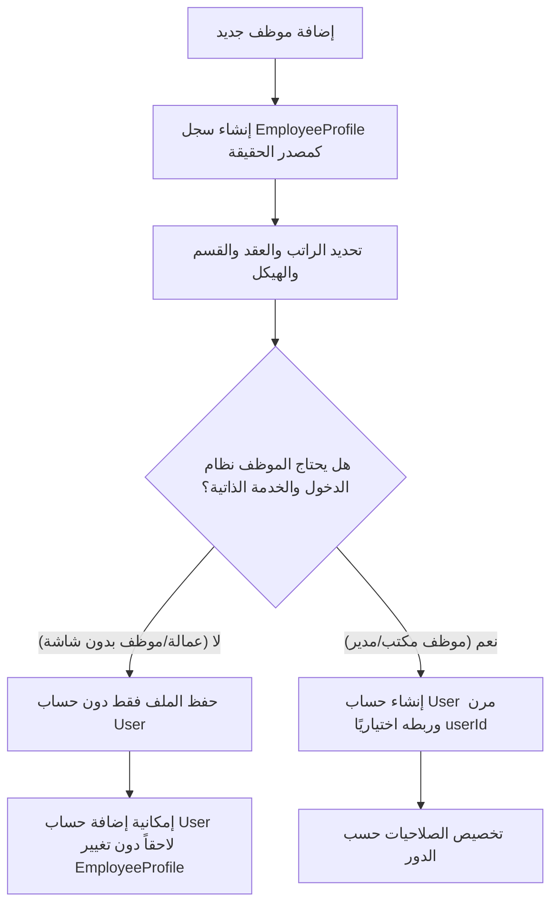
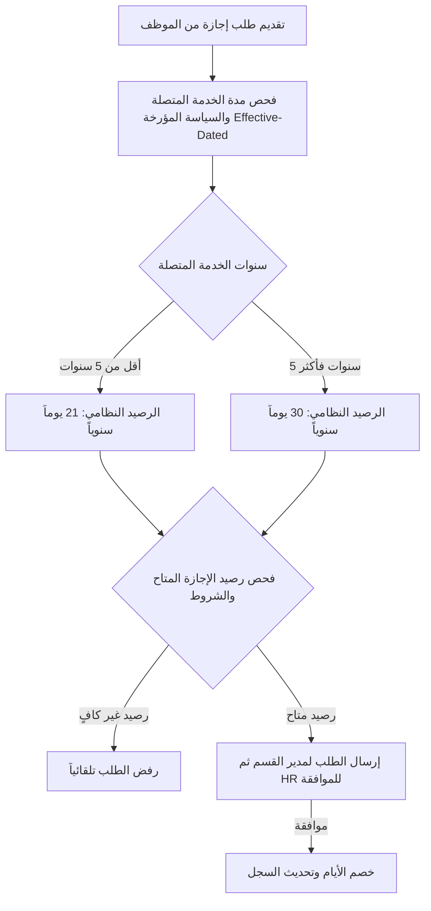
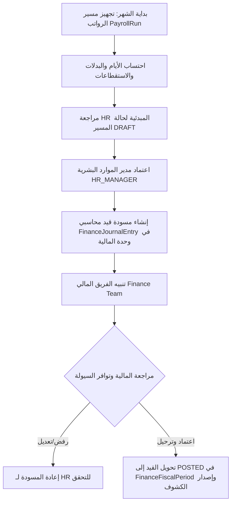
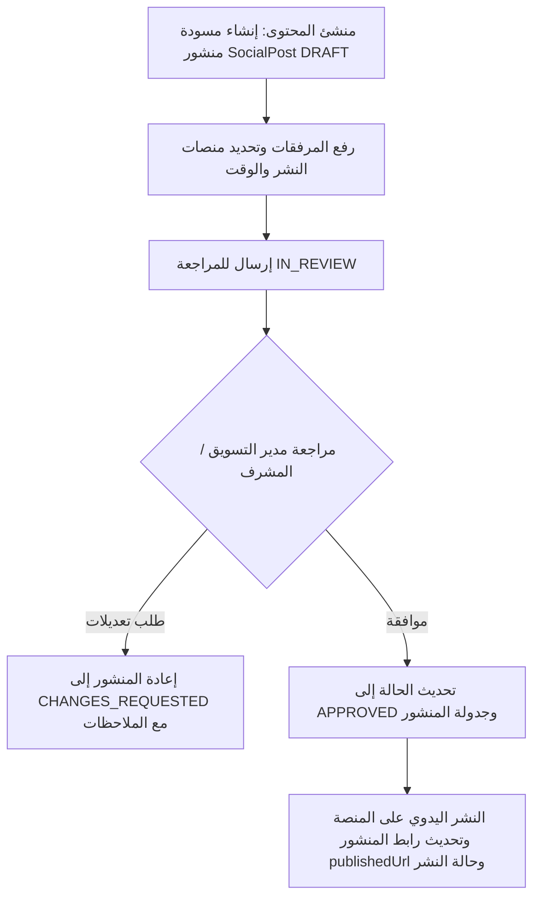
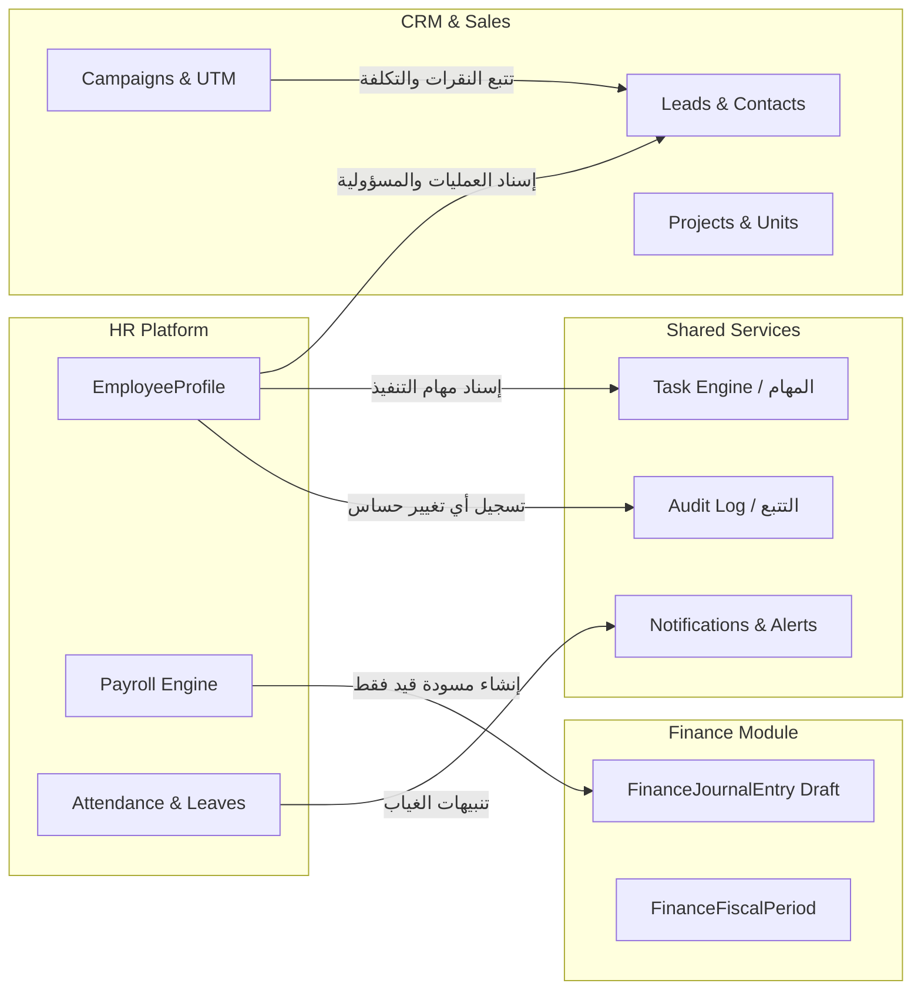

# NAHT Unified Operations & HR Platform Architecture Blueprint
**الوثيقة المرجعية المعمارية الشاملة لمنصة الموارد البشرية والعمليات الموحدة داخل بوابة نحت العقارية (`/crm`)**

---

## 1. الملخص التنفيذي والقرارات المعمارية المعتمدة (Executive Summary & Architectural Decisions)

### 1.1 الرؤية والهدف
إنشاء منصة تشغيلية وموارد بشرية (HR & Operations Platform) أصلية وتكاملية 100% داخل **بوابة نحت العقارية (`/crm`)**، تستند إلى البنية التحتية الحالية المعتمدة على **Next.js 16.2.9 (Turbopack)، Prisma ORM، NextAuth.js، وSoD Finance Architecture**.

الهدف ليس "دمج" أو "نسخ" كود النظام القديم (`NAHT-CRM-SITE`) كما هو، بل استخلاص وظائفه المتقدمة وتجربته البصرية المتميزة (Dark Mode، الهوية البصرية بنمط الثمانية، الرسوم البيانية، تتبع المنصات الإعلانية، ومركز المحتوى)، وإعادة بنائها بأعلى معايير الأمان والهيكلية النظيفة، وتكاملها مع متطلبات **شاشة الموارد البشرية** (إدارة الموظفين، العقود، الإجازات، العلاقات الحكومية، والأداء).

### 1.2 القرارات المعمارية والتجارية النهائية والملزمة (Final Architectural & Business Directives)

1. **التقنية المعتمدة (Next.js 16.2.9 Turbopack):**
   - الاعتماد الكامل على Next.js 16.2.9 مع Turbopack في بيئة التطوير والبناء الإنتاجي.
   - استمرار الاعتماد المباشر على NextAuth.js لتوثيق الجلسات وسجل الـ Session الموحد.
   - حظر تام لنسخ أو استدعاء `dashboard.js` أو أي نصوص سكريبت قديمة، وحظر استدعاء Supabase Client أو Google Scripts أو مفاتيح خارجية من العميل.

2. **الربط المباشر مع النماذج الموجودة دون تكرار (Domain Reuse):**
   - إعادة استخدام النماذج الحالية في `prisma/schema.prisma` كصحة مصدر مرجعية (Single Source of Truth): `User` و `Department` و `Lead` و `Project` و `CampaignLink` و `ClickEvent` و `Task` و **`FinanceFiscalPeriod`** و **`FinanceJournalEntry`**.

3. **الفصل المعماري والسيادة بين الموظف ومستخدم النظام (`EmployeeProfile` vs `User`):**
   - نموذج **`EmployeeProfile`** هو **مصدر الحقيقة المباشر والوحيد** للبيانات الوظيفية (معلومات الموظف، الراتب والبدلات، العقد، القسم، الهيكل الإداري).
   - نموذج **`User`** مسؤول **حصرياً عن الهوية والمصادقة وبيانات الدخول**.
   - العلاقة بين الموظف والمستخدم هي علاقة اختيارية **One-to-Zero-or-One (`userId?`)**.
   - **لا يُنشأ حساب دخول `User` تلقائياً لكل موظف**؛ يُنشأ الحساب فقط عندما يحتاج الموظف فعلياً إلى: الخدمة الذاتية، تقديم الطلبات، الموافقات، الاطلاع على كشف الراتب، إدارة فريق، أو تنفيذ مهام داخل النظام.
   - النظام يدعم إنشاء حساب الموظف لاحقاً دون تغيير `EmployeeProfile` أو فقدان بياناته الوظيفية، مع منع ربط أكثر من موظف بالحساب نفسه.

4. **الفصل الصارم للواجبات المالية (Segregation of Duties - SoD):**
   - أي عملية مالية ناتجة عن الموارد البشرية أو المصروفات لا تقوم بإنشاء أو ترحيل قيد محاسبي مباشر نهائياً.
   - تقوم منصة HR بإنشاء **مسودة قيد محاسبي (`FinanceJournalEntry` بحالة DRAFT)** فقط، وتنتقل العملية إلى وحدة المالية (`/crm/finance`) للتحقق والاعتماد والترحيل المالي المستقل بواسطة المستويات المالية المصرحة (`finance.journal.create` & `finance.journal.post`).

5. **سياسة الإجازات السنوية المرنة والالتزام بنظام العمل السعودي (Saudi Labor Law & Effective-Dated Policies):**
   - تطبيق القاعدة الافتراضية المعتمدة في نظام العمل السعودي:
     - 21 يوماً سنوياً لمن كانت خدمته أقل من 5 سنوات متصلة.
     - 30 يوماً سنوياً بعد إكمال 5 سنوات متصلة.
   - السماح بإعداد سياسات أعلى حسب المنشأة عبر **سياسات قابلة للإعداد ومؤرخة بالصلاحية (Effective-Dated Policies)** دون كتابة أرقام ثابتة (Hardcoded) داخل الكود.
   - **لا يوجد ترحيل تلقائي مفتوح أو غير محدود**؛ ترحيل الرصيد إلى السنة التالية يتطلب موافقة موثقة وسياسة تحدد الحد الأقصى والمدة.
   - دعم التأجيل النظامي للإجازة مع تسجيل السبب والموافقة وتاريخ انتهاء الرصيد المرحل.
   - لا تُحذف الأرصدة آلياً دون تسوية موثقة واعتماد رسمي من قسم الموارد البشرية.

6. **حماية أمنية مشددة لبيانات الهوية والرواتب والبنوك (Data Protection & Privacy Security Controls):**
   - **تفويض على مستوى الحقل (Field-Level Authorization):** حماية حقول الهوية الوطنية، الجواز، الراتب والبدلات، والحساب البنكي (IBAN) بصلاحيات خاصة (`hr.salary.view`, `hr.id.view`) حتى داخل واجهات الموظفين.
   - **قناع البيانات (Data Masking):** إخفاء جزئي للبيانات الحساسة في الواجهات والأنظمة المساعدة (مثال: `SA****************1234` و `10******89`).
   - **سجل التدقيق الشامل (Audit Logging):** تسجيل استثنائي لأي عملية وصول أو تعديل أو تصدير لبيانات الهوية والرواتب والبنوك.
   - **منع التسريب في الميتاداتا (Zero Metadata Leakage):** استبعاد البيانات الحساسة تماماً من أطر الميتاداتا العامة أو سجلات الـ Logs.
   - **روابط موقعة مؤقتة (Signed URLs):** حماية المستندات والوثائق الرسمية بروابط موقعة ومحدودة بالزمن.

7. **نطاق مركز المحتوى والتسويق (Social Content Center - Phase 1 vs Phase 2):**
   - **المرحلة الأولى (Phase 1 MVP):** تقويم محتوى داخلي، مسودات، رفع ملفات الميديا، مسار مراجعة واعتماد (مسودة -> مراجعة -> طلب تعديل -> اعتماد -> جدولة)، نشر يدوي مع تسجيل رابط المنشور وحالة النشر، وسجل إصدارات وتعليقات.
   - **المرحلة الثانية (Phase 2):** الربط المباشر عبر API مع المنصات (TikTok, Meta, X, Snapchat) بعد إعداد OAuth المشفر والمراجعة القانونية لشروط المنصات.
   - **حظر أمني مطلق:** يمنع منعاً باتاً تخزين رموز الوصول (Access Tokens) أو أسرار التطبيقات (Client Secrets) داخل متصفح العميل أو Client Components.

8. **نطاق المصروفات والرحلات (Expenses & Travel - Phase 1 vs Phase 2):**
   - **المرحلة الأولى (Phase 1 MVP):** الدورة الداخلية كاملة (إنشاء طلب، إرفاق الفواتير والعروض، اعتماد المدير، اعتماد HR، اعتماد المالية، تسجيل الحجز أو المصروف يدوياً، التسوية، وإنشاء **مسودة قيد مالي `FinanceJournalEntry` DRAFT** بعد الاعتماد النهائي).
   - **المرحلة الثانية:** عدم وجود ربط خارجي مع مزودي حجوزات في MVP، مع تصميم البنية بواجهة محول مستقلة (`Provider Adapter Interface`) تسمح بالربط المستقبلي دون تعديل دورة الطلب.

---

## 2. جرد الوظائف الموجودة حالياً في البوابة الحالية (Current Portal Inventory)

تحتوي البوابة الحالية (`/crm`) على النواة التالية المثبتة والمفحوصة:

| الموديل / الوظيفة | المكونات والمسارات الحالية | الحالة والجهوزية |
| :--- | :--- | :--- |
| **المصادقة والأدوار** | NextAuth session, Impersonation (`/crm/settings/impersonation`), Roles & Permissions (`/crm/settings/roles`) | جاهز ومفحوص أمنياً (Batch 1) |
| **إدارة العملاء والطلبات** | Leads (`/crm/leads`), Contact Requests (`/crm/requests/contact`), Careers/Maintenance/Vendor Requests (`/crm/requests/*`) | جاهز ومفحوص أمنياً (Batch 1 & 4A) |
| **المشاريع والوحدات** | Projects (`/crm/projects`), Models, Units (`/crm/projects/[id]/units`), Interactive Map (`/crm/projects-map`) | جاهز ومفحوص أمنياً (Batch 2) |
| **الحملات والروابط** | Campaigns (`/crm/campaigns`), Builder (`/crm/campaigns/new`), Tracking (`/crm/tracking`) | جاهز ومفحوص أمنياً (Batch 2) |
| **إدارة المهام** | Task Board (`/crm/tasks`), Dynamic Details Drawer (`TaskDetailsDrawer.tsx`), Action Logs | جاهز ومفحوص أمنياً (Batch 1 & 3) |
| **المكتبة المالية النظيفة** | Finance Dashboard (`/crm/finance`), Journals (`FinanceJournalEntry`), Periods (`FinanceFiscalPeriod`) | جاهز ومفحوص أمنياً (مستقل) |
| **الهيكل التنظيمي** | Departments (`/crm/organization/departments`), Members (`/crm/organization/members`) | جاهز ومفحوص أمنياً (Batch 1) |

---

## 3. جرد وظائف المشروع القديم وملف الموارد البشرية (Legacy System & HR Doc Inventory)

### 3.1 جرد وظائف المشروع القديم (`NAHT-CRM-SITE - Copy.zip`)
- **لوحة التحليلات المتقدمة (Marketing Analytics Dashboard):** رسم بياني لمصادر العملاء (Snapchat, TikTok, Meta, Google, Twitter, WhatsApp)، مقارنات الفترات، معدل التحويل (Funnel Chart)، والأنماط الزمنية.
- **ربط المنصات الإعلانية (Marketing Ad Platform Integration):** تتبع الحملات المباشرة، الإنفاق، الانطباعات، النقرات، متوسط CPC، وCTR لكل منصة.
- **منشئ روابط UTM ومراقبة الواتساب:** إنشاء روابط تتبع دقيقة، وتتبع نقرات زر الواتساب المباشرة (`ClickEvent`).
- **مركز إدارة المحتوى واعتماده (Social Content Center):** تقويم المنشورات (Calendar View)، دورة مسار الاعتماد (مسودة -> مراجعة -> جدولة -> نشر يدوي)، المرفقات، ملاحظات المدير والمرشح.
- **التصاميم والخطوط والهوية البصرية:** خط الثمانية (Thmanyah Sans)، ألوان النحت العقارية (`#0b1214` و `#c5af8d`)، الوضع الداكن (Dark Mode).

### 3.2 جرد وظائف ملف الموارد البشرية (`شاشة الموارد البشرية (1).docx`)
- **لوحة الموارد البشرية الرئيسية (HR Dashboard):** ملخص الموظفين، التذكيرات العاجلة (تجديد العقود والإقامات والتأمين)، الوارد والوثائق النظامية، مستجدات الموظفين (تحت التجربة، تعيينات جديدة، ترقيات)، ومتابعة حضور الفريق اللحظي.
- **إدارة الموظفين (Employee Profiles):** الرقم الوظيفي، الإدارة، رصيد الإجازات، كشوف الرواتب، والعقد.
- **الطلبات والموافقات (Employee Requests):** الإجازات، الاستئذان، القروض، والنفقات عبر مسار عمل تلقائي.
- **العلاقات الحكومية (Government Relations):** متابعة الإقامات، التأشيرات، نقل الخدمات، والتأمين الطبي.
- **مسير الرواتب (Payroll Engine):** إعداد الرواتب، الاستقطاعات، البدلات، وربطه بالمالية.
- **التوظيف والمواهب (Talent & Recruitment):** إدارة الوظائف الشاغرة، الترشيح، والإحالات.
- **الأداء والتعلم (Performance & L&D):** تقييم الأداء، استطلاعات الرأي، والدورات التدريبية.
- **إدارة النفقات والرحلات (Expenses & Travel Bookings):** تقديم المطالبات وتذاكر الطيران.
- **العمليات السريعة (Quick Operations):** زر عائم لإضافة موظف، إنشاء عقد، تسجيل إجازة، إصدار خطاب، ورفع مستند.

---

## 4. تحليل الفجوات والجاهزية المعمارية (Gap Analysis)

| الوظيفة / المكون | الفئة المعمارية | التقييم والتوجيه الفني |
| :--- | :--- | :--- |
| **توثيق الحسابات والأدوار** | موجود وتتم إعادة استخدامه | استخدام NextAuth.js و Prisma User/Role بالحالية دون تعديل. |
| **إدارة العملاء والمشاريع والحملات** | موجود وتتم إعادة استخدامه | الاعتماد الكامل على النماذج والصفحات المحسنة في الدفعات (1-4A). |
| **المالية والمحافظ المحاسبية** | موجود وتتم إعادة استخدامه | استخدام `FinanceFiscalPeriod` و `FinanceJournalEntry` دون تعديل مسميات. |
| **إدارة الموظفين والملف الوظيفي** | غير موجود (MVP 1) | إنشاء نموذج `EmployeeProfile` كمصدر الحقيقة والربط الاختياري بـ `User`. |
| **العقود والوثائق الرسمية** | غير موجود (MVP 2) | إنشاء جداول `EmployeeContract` و `GovernmentDoc` والتنبيهات المباشرة. |
| **الإجازات والخدمة الذاتية** | غير موجود (MVP 3 & 4) | تطبيق قواعد نظام العمل السعودي مع السياسات المؤرخة Effective-Dated. |
| **مركز المحتوى الاجتماعي (Phase 1)** | غير موجود (مرحلة مستقلة) | بناء تقويم المحتوى والاعتماد الداخلي مع النشر اليدوي دون API خارجية. |
| **مسير الرواتب والمستحقات** | غير موجود (مرحلة لاحقة) | بناء محرّك الرواتب مع ربطه التلقائي بإنشاء مسودة قيد `FinanceJournalEntry`. |
| **نظام التسجيل والربط القديم** | **مستبعد أمنياً بالكامل** | حظر `dashboard.js` و Supabase و Google Script والتوثيق القديم 100%. |

---

## 5. خريطة الوحدات والمسارات المقترحة داخل `/crm` (Module & Route Map)

```text
src/app/crm/
├── (core)
│   ├── page.tsx                           # اللوحة الرئيسية العامة للـ CRM
│   ├── leads/                             # العملاء المحتملين
│   ├── projects/                          # المشاريع والوحدات
│   ├── campaigns/                         # الحملات ومنشئ UTM
│   └── tasks/                             # نظام المهام الموحد
├── hr/                                    # منصة الموارد البشرية والعمليات
│   ├── page.tsx                           # لوحة قيادة الموارد البشرية (HR Dashboard)
│   ├── employees/                         # قائمة الموظفين والملفات الوظيفية (MVP 1)
│   │   ├── page.tsx
│   │   ├── new/page.tsx
│   │   └── [id]/
│   │       ├── page.tsx                   # تفاصيل الموظف والملف الكامل
│   │       ├── edit/page.tsx
│   │       └── salary/page.tsx            # تفاصيل الراتب والبدلات المشفرة
│   ├── leaves/                            # الإجازات والاستئذانات (MVP 3)
│   │   ├── page.tsx                       # قائمة الطلبات والموافقة
│   │   └── new/page.tsx
│   ├── contracts/                         # العقود والوثائق الرسمية (MVP 2)
│   │   ├── page.tsx                       # العقود والتذكيرات العاجلة
│   │   └── [id]/page.tsx
│   ├── government/                        # العلاقات الحكومية والتأمين (MVP 2)
│   │   ├── page.tsx                       # الإقامات والتأشيرات والتأمين الطبي
│   │   └── visas/page.tsx
│   ├── self-service/                      # الخدمة الذاتية للموظف (MVP 4)
│   │   ├── page.tsx                       # طلباتي، رصيدي، وكشوف راتبي
│   │   └── payslips/page.tsx
│   ├── payroll/                           # [مرحلة لاحقة] مسير الرواتب والمستحقات
│   │   ├── page.tsx                       # كشوف الرواتب الشهرية
│   │   └── [id]/page.tsx                  # مسير محدد ومراجعة الاستقطاعات
│   └── expenses/                          # [مرحلة لاحقة] النفقات والرحلات
│       └── page.tsx                       # مطالبات المصروفات والتسوية
├── marketing/                             # مركز المحتوى والتسويق
│   ├── content/                           # [Phase 1] مركز المحتوى وتقويم المنشورات
│   │   ├── page.tsx                       # التقويم وقائمة الجدولة
│   │   └── review/[id]/page.tsx           # شاشة اعتماد المنشور والنشر اليدوي
│   └── analytics/                         # [Phase 2] ربط وتحليلات المنصات الإعلانية
│       └── page.tsx                       # إنفاق الحملات والتحويلات
├── reports/                               # التقارير الإدارية والتقرير الأسبوعي (MVP 5)
│   ├── page.tsx                           # مركز التقارير الشامل
│   └── weekly/page.tsx                    # التقرير الأسبوعي التفاعلي والطباعة
└── audit/                                 # السجل الشامل والتدقيق
    └── page.tsx                           # سجل العمليات وتغييرات النظام الحساسة
```

---

## 6. خريطة تنقل الشريط الجانبي المقترحة (Proposed Sidebar Navigation Map)

يتم تحديث المكون `CrmSidebar.tsx` ليعكس الهيكلية المنظمة في مجموعات قابلة للطي حسب الصلاحيات:

```text
📌 القائمة الرئيسية (Main Navigation)
├── 🏠 الرئيسية (CRM Overview)             -> /crm
├── 🎯 العملاء والفرص (Leads & Sales)     -> /crm/leads
├── 🏢 المشاريع والوحدات (Projects & Map)   -> /crm/projects
├── 🚀 الحملات والتتبع (Marketing & UTM)  -> /crm/campaigns
└── 📋 المهام والأنشطة (Tasks & Board)    -> /crm/tasks

👥 الموارد البشرية والعمليات (HR Platform)
├── 📊 لوحة قيادة HR (HR Dashboard)       -> /crm/hr
├── 👔 الموظفون (Employees Directory)     -> /crm/hr/employees
├── ⏱️ الإجازات والطلبات (Leaves & Requests)-> /crm/hr/leaves
├── 📜 العقود والوثائق (Contracts & Govt)  -> /crm/hr/contracts
├── 🙋 الخدمة الذاتية (Employee Self-Service)-> /crm/hr/self-service
└── 💰 مسير الرواتب (Payroll Engine)      -> /crm/hr/payroll [مرحلة لاحقة]

📣 التسويق والمحتوى (Marketing & Content)
├── 📅 تقويم المحتوى (Social Content)     -> /crm/marketing/content
└── 📈 تحليلات المنصات (Ads Analytics)     -> /crm/marketing/analytics [Phase 2]

📊 التقارير والإدارة (Management & Audit)
├── 📑 التقارير والتقرير الأسبوعي          -> /crm/reports/weekly
├── 🛡️ سجل التدقيق والأنشطة               -> /crm/audit
└── ⚙️ الإعدادات والأدوار                 -> /crm/settings/roles
```

---

## 7. مصفوفة الأدوار والصلاحيات التفصيلية (Detailed Roles & Permissions Matrix)

تعتمد المصفوفة على نطاقات الشفافية المقيدة أمنياً (**Fail-Closed Scoping**):

| رمز الصلاحية (Permission Code) | ADMIN | HR_MANAGER | DEPT_MANAGER | EMPLOYEE (مع User) | SALES / MARKETING |
| :--- | :---: | :---: | :---: | :---: | :---: |
| `hr.employee.view` | COMPANY | COMPANY | DEPARTMENT | SELF | NONE |
| `hr.employee.manage` | YES | YES | NO | NO | NO |
| `hr.salary.view` (Field-Level) | COMPANY | COMPANY | NONE | SELF | NONE |
| `hr.salary.manage` | YES | YES | NO | NO | NO |
| `hr.leave.request` | YES | YES | YES | SELF | YES |
| `hr.leave.approve` | COMPANY | COMPANY | DEPARTMENT | NO | NO |
| `hr.contract.manage` | YES | YES | NO | NO | NO |
| `marketing.content.create` | YES | NO | NO | NO | YES |
| `marketing.content.approve` | YES | NO | DEPT_MGR | NO | NO |
| `finance.journal.create_draft` | AUTO (HR) | AUTO (HR) | NO | NO | NO |
| `finance.journal.post` | FINANCE | FINANCE | NO | NO | NO |

---

## 8. مخطط نماذج البيانات المقترح والعلاقات (Proposed Data Models & Schema Design)

*ملاحظة: هذا المخطط المعماري يمثل التغييرات المستقبلية في `prisma/schema.prisma` دون تطبيق أي Migration في هذه الجولة.*

```prisma
// ==========================================
// 1. HR CORE & EMPLOYEE PROFILE (Single Source of Truth)
// ==========================================

enum EmployeeStatus {
  PROBATION     // تحت التجربة
  ACTIVE        // نشط
  SUSPENDED     // موقوف
  TERMINATED    // منتهي الخدمة
  RESIGNED      // مستقيل
}

enum EmploymentType {
  FULL_TIME
  PART_TIME
  CONTRACT
  INTERN
}

model EmployeeProfile {
  id                  String         @id @default(cuid())
  employeeNumber      String         @unique // الرقم الوظيفي
  fullNameAr          String
  fullNameEn          String?
  nationalId          String         @unique // رقم الهوية / الإقامة (مشفّر في الواجهة)
  passportNumber      String?
  nationality         String
  gender              String?
  dateOfBirth         DateTime?
  joiningDate         DateTime
  probationEndDate    DateTime?
  status              EmployeeStatus @default(PROBATION)
  employmentType      EmploymentType @default(FULL_TIME)
  jobTitle            String

  // العلاقات الأساسية
  departmentId        String
  department          Department     @relation(fields: [departmentId], references: [id])

  // ربط اختياري مع المستخدم (One-to-Zero-or-One)
  userId              String?        @unique
  user                User?          @relation(fields: [userId], references: [id])

  managerId           String?
  manager             EmployeeProfile?  @relation("EmployeeHierarchy", fields: [managerId], references: [id], onDelete: SetNull)
  subordinates        EmployeeProfile[] @relation("EmployeeHierarchy")

  // البيانات المالية والرواتب (محمية بـ Field-Level Permission)
  basicSalary         Decimal        @default(0) @db.Decimal(12, 2)
  housingAllowance    Decimal        @default(0) @db.Decimal(12, 2)
  transportAllowance  Decimal        @default(0) @db.Decimal(12, 2)
  otherAllowances     Decimal        @default(0) @db.Decimal(12, 2)
  ibanNumber          String?        // مشفّر جزئياً SA****************1234
  bankName            String?

  // رصيد الإجازات المحسوب وفق نظام العمل والسياسات المؤرخة
  annualLeaveBalance  Float          @default(21.0)
  carriedOverBalance  Float          @default(0.0)
  carriedOverExpiry   DateTime?

  // العلاقات الفرعية
  contracts           EmployeeContract[]
  leaves              EmployeeLeave[]
  payrollItems        PayrollItem[]
  documents           EmployeeDocument[]
  expenses            ExpenseClaim[]

  createdAt           DateTime       @default(now())
  updatedAt           DateTime       @updatedAt
}

model LeavePolicyRule {
  id                  String         @id @default(cuid())
  policyName          String         // سياسة إجازات المنشأة
  minYearsService     Int            @default(0)
  maxYearsService     Int            @default(5)
  annualDays          Int            @default(21) // 21 أو 30 حسب نظام العمل والسياسة
  allowRollover       Boolean        @default(false)
  maxRolloverDays     Int            @default(0)
  effectiveFrom       DateTime
  effectiveTo         DateTime?
  createdAt           DateTime       @default(now())
}

model EmployeeContract {
  id                  String          @id @default(cuid())
  employeeId          String
  employee            EmployeeProfile @relation(fields: [employeeId], references: [id], onDelete: Cascade)
  contractNumber      String          @unique
  startDate           DateTime
  endDate             DateTime
  noticePeriodDays    Int             @default(30)
  isRenewable         Boolean         @default(true)
  status              String          @default("ACTIVE") // ACTIVE, EXPIRED, TERMINATED
  documentUrl         String?         // رابط موقع مؤقت Signed URL
  createdAt           DateTime        @default(now())
}

model EmployeeLeave {
  id                  String          @id @default(cuid())
  employeeId          String
  employee            EmployeeProfile @relation(fields: [employeeId], references: [id], onDelete: Cascade)
  type                String          // ANNUAL, SICK, UNPAID, EMERGENCY
  startDate           DateTime
  endDate             DateTime
  daysCount           Float
  reason              String?
  status              String          @default("PENDING") // PENDING, APPROVED, REJECTED
  approvedById        String?
  rejectionReason     String?
  createdAt           DateTime        @default(now())
}

model PayrollRun {
  id                  String          @id @default(cuid())
  periodMonth         Int             // 1-12
  periodYear          Int
  totalBasic          Decimal         @db.Decimal(14, 2)
  totalAllowances     Decimal         @db.Decimal(14, 2)
  totalDeductions     Decimal         @db.Decimal(14, 2)
  totalNet            Decimal         @db.Decimal(14, 2)
  status              String          @default("DRAFT") // DRAFT, APPROVED, JOURNAL_CREATED
  draftJournalEntryId String?         // ربط مسودة القيد بالمالية (FinanceJournalEntry)
  items               PayrollItem[]
  createdAt           DateTime        @default(now())
}

model PayrollItem {
  id                  String          @id @default(cuid())
  payrollRunId        String
  payrollRun          PayrollRun      @relation(fields: [payrollRunId], references: [id], onDelete: Cascade)
  employeeId          String
  employee            EmployeeProfile @relation(fields: [employeeId], references: [id])
  basicSalary         Decimal         @db.Decimal(12, 2)
  allowances          Decimal         @db.Decimal(12, 2)
  deductions          Decimal         @db.Decimal(12, 2)
  netSalary           Decimal         @db.Decimal(12, 2)
  notes               String?
}

// ==========================================
// 2. MARKETING CONTENT & SOCIAL CENTER (Phase 1 Internal)
// ==========================================

model SocialPost {
  id                  String          @id @default(cuid())
  title               String
  caption             String          @db.Text
  platforms           String[]        // ["TIKTOK", "INSTAGRAM", "X", "SNAPCHAT"]
  mediaUrls           String[]
  scheduledAt         DateTime?
  publishedAt         DateTime?
  publishedUrl        String?         // رابط المنشور الفعلي بعد النشر اليدوي
  status              String          @default("DRAFT") // DRAFT, IN_REVIEW, CHANGES_REQUESTED, APPROVED, PUBLISHED
  projectId           String?
  project             Project?        @relation(fields: [projectId], references: [id])
  authorId            String
  author              User            @relation("PostAuthor", fields: [authorId], references: [id])
  approverId          String?
  approver            User?           @relation("PostApprover", fields: [approverId], references: [id])
  managerNote         String?
  createdAt           DateTime        @default(now())
  updatedAt           DateTime        @updatedAt
}

// ==========================================
// 3. AUDIT LOG & SENSITIVE ACCESS TRAIL
// ==========================================

model AuditLog {
  id                  String          @id @default(cuid())
  actorId             String
  actorEmail          String
  action              String          // VIEW_SALARY, CREATE_EMPLOYEE, APPROVE_LEAVE, etc.
  targetResource      String          // EmployeeProfile, PayrollRun, etc.
  targetId            String?
  metadataJson        String?         @db.Text // خالي من البيانات الحساسة المباشرة
  ipAddress           String?
  createdAt           DateTime        @default(now())
}
```

---

## 9. مخططات سير العمل الرئيسية (Workflow Diagrams)

### 9.1 سير عمل إنشاء الموظف والربط الاختياري بـ User



### 9.2 سير عمل احتساب الإجازات وفق نظام العمل والسياسات المؤرخة (Effective-Dated Leave Policy)



### 9.3 سير عمل الرواتب والربط المالي الصارم (Payroll to Draft Journal Entry)



### 9.4 سير عمل اعتماد المحتوى والنشر اليدوي (Social Content Phase 1)



---

## 10. حدود التكامل بين الأنظمة (Integration Boundaries)



---

## 11. تقسيم المراحل التنفيذية (Phased Implementation Roadmap & MVP Chunks)

### 🎯 المرحلة الأساسية الأولى (MVP Scope):
- **MVP 1 (HR Core):** إنشاء نموذج `EmployeeProfile` ككيان مستقل ومصدر الحقيقة، وواجهات إدارة الموظفين (`/crm/hr/employees`).
- **MVP 2 (العقود والوثائق الرسمية):** متابعة العقود والإقامات والتأشيرات والتأمين الطبي مع التنبيهات والتذكيرات العاجلة (`/crm/hr/contracts`).
- **MVP 3 (الإجازات والطلبات):** طلبات الإجازات والاستئذان مع تطبيق قواعد نظام العمل السعودي والسياسات المؤرخة (`/crm/hr/leaves`).
- **MVP 4 (الخدمة الذاتية للموظفين):** واجهة الخدمة الذاتية (`/crm/hr/self-service`) للموظفين المرتبطين بـ `User`.
- **MVP 5 (التنبيهات والتقارير الأساسية):** التقرير الأسبوعي والتذكيرات العاجلة واللوحة التنفيذية (`/crm/reports/weekly`).

### 🚀 المراحل المستقلة اللاحقة (Subsequent Independent Phases):
- **Phase 2A (مسير الرواتب والربط المالي):** محرك كشوف الرواتب وإنشاء مسودات قيود `FinanceJournalEntry`.
- **Phase 2B (مركز المحتوى الاجتماعي - Phase 1 Internal):** التقويم والاعتماد والنشر اليدوي.
- **Phase 2C (المصروفات والرحلات الدورة الداخلية):** المطالبات واعتماد الفواتير اليدوي.
- **Phase 3 (الربط الخارجي - Marketing APIs & Travel Providers):** OAuth والربط المباشر مع المنصات الإعلانية ومزودي الرحلات.

---

## 12. معايير القبول وااختبارات كل Chunk (Acceptance Criteria)

لكل Chunk تنفيذي، يجب استيفاء المعايير التالية قبل الاعتماد:
1. **ESLint Strict:** اجتياز فحص `npx eslint --max-warnings=0` للكون مكونات الـ Chunk.
2. **TypeScript Integrity:** خلو تام من أخطاء الـ Compilation عبر `npx tsc --noEmit`.
3. **Encoding Verification:** خلو كامل من الـ BOM و 0 Mojibake (`Ø`, `Ù`).
4. **Clean Diff Check:** اجتياز `git diff --check` بدون أي مسافات زائدة.
5. **Production Build:** نجاح البناء الكامل عبر `npx next build`.
6. **Zero Raw Error Leakage:** عدم عرض أي رسائل أخطاء Prisma أو SQL خام للعميل.

---

## 13. مخاطر الأمان والخصوصية وحماية البيانات (Security & Data Protection Risks)

| خيار الخطر | مستوى الخطورة | إجراء الوقاية والمعالجة المعمارية |
| :--- | :---: | :--- |
| **تسريب بيانات الرواتب والهويات** | **عالي جداً (Critical)** | تفويض الحقول Field-Level Authorization وإخفاء البيانات Masking وحجبها عن metadata العامة. |
| **تخطي SoD المالي وتحويل أموال مباشر** | **عالي جداً (Critical)** | اقتصار مخرجات HR والرواتب على إنشاء مسودة قيد `FinanceJournalEntry` فقط دون ترحيل. |
| **كشف أسرار المنصات الإعلانية** | **عالي (High)** | حظر تخزين مفاتيح API أو Access Tokens في متصفح العميل أو Client Components نهائياً. |
| **تجاوز الصلاحيات عبر تعديل ID URL** | **عالي (High)** | تطبيق Fail-Closed Guard والتحقق من النطاق (`SELF`, `DEPARTMENT`, `COMPANY`) في خادم الصفحة قبل إرجاع أي بيانات. |

---

**حالة الوثيقة:** معتمدة بجميع القرارات التجارية والتعديلات المعمارية النهائية، وجاهزة للتنفيذ المرحلي عند طلب البدء.
